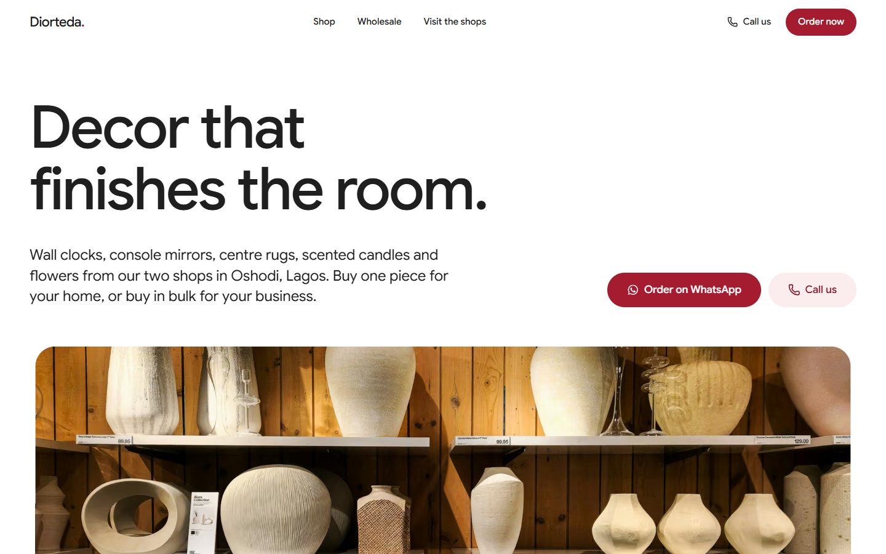
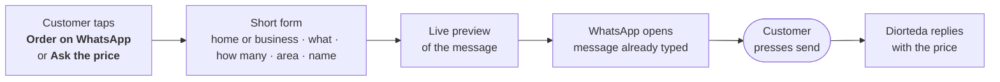
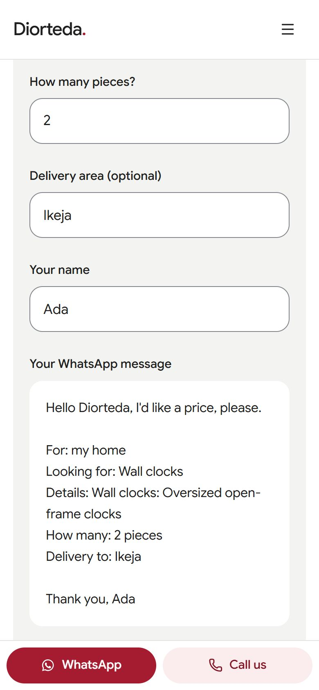
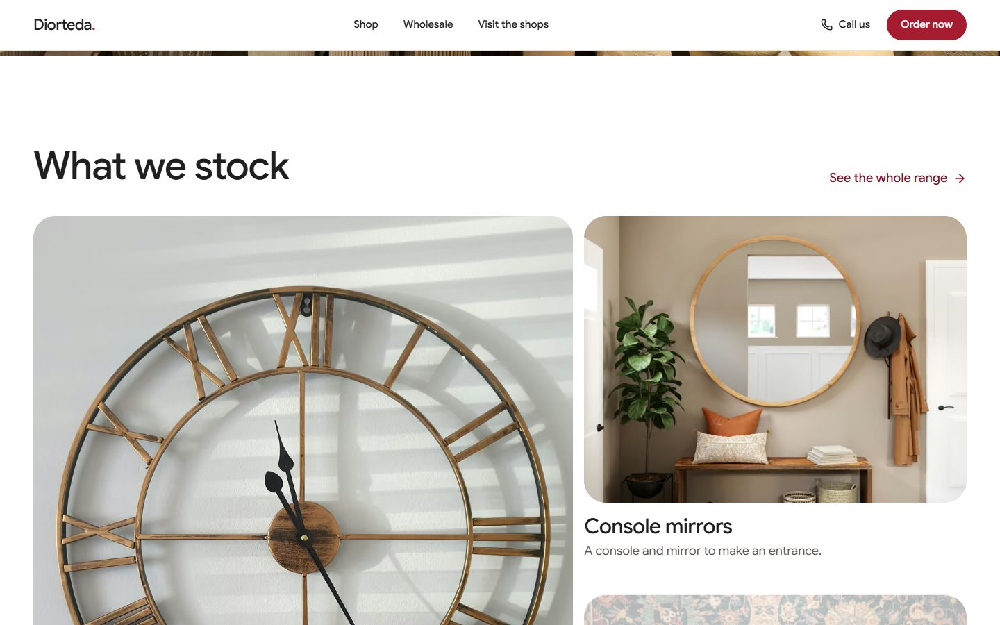
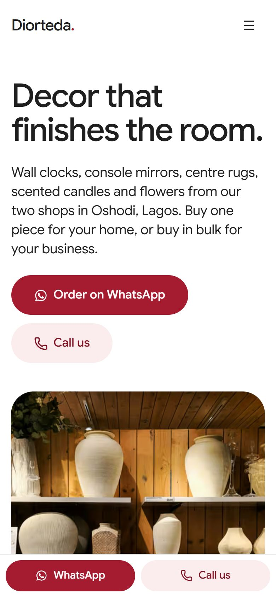
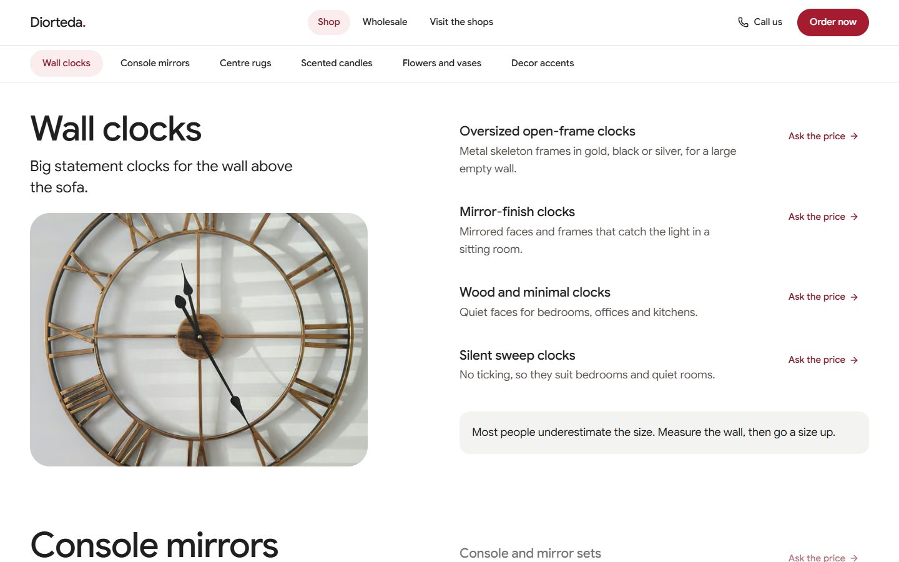

<div align="center">

<br />

# Diorteda Interiors

**The website for Diorteda Interiors, home decor and interior accessories in Oshodi, Lagos.**
<br />
Wall clocks · Console mirrors · Centre rugs · Scented candles · Flowers · Decor accents
<br />
Retail and wholesale, with every order sent straight to WhatsApp.

<br />


<br />



</div>

<br />

## Why it exists

Diorteda sells from two shops in Oshodi and takes most of its orders on WhatsApp and Instagram. This site gives customers one clear place to see the range, find the shops and order, without breaking how the business already works.

> **The rule:** never make a customer copy, paste or retype anything. They tap, fill in a short form, and WhatsApp opens with their order already written. They just press send.

<br />

## How an order reaches the shop



<table>
  <tr>
    <td width="50%" valign="top">
      
    </td>
    <td width="50%" valign="top">

**What the customer fills in**

| | |
| --- | --- |
| Who it's for | My home, or My business (wholesale) |
| What they need | Tap one or more categories |
| Details | Optional: size, colour, the post they saw |
| How many | Number of pieces |
| Delivery area | Optional |
| Name | So the shop knows who's asking |

**What lands in Diorteda's WhatsApp**

```text
Hello Diorteda, I'd like a price, please.

For: my business (wholesale)
Looking for: Centre rugs
How many: 3 pieces
Delivery to: Lekki Phase 1

Thank you, Ada
```

Every **Ask the price** link on the shop page fills in the item for them.

</td>
  </tr>
</table>

<br />

## A look around

<table>
  <tr>
    <td width="62%"></td>
    <td width="38%"></td>
  </tr>
  <tr>
    <td colspan="2"></td>
  </tr>
</table>

| Page | What's on it |
| --- | --- |
| **Home** | The range at a glance, retail vs wholesale, a *Where's it going?* room picker, Instagram, both shops |
| **Shop** | All six categories, each style with an *Ask the price* link |
| **Wholesale** | Who buys in bulk, how a trade order works, questions answered |
| **Visit the shops** | Both addresses, directions, what to know before coming |
| **Order on WhatsApp** | The form that writes the order and opens WhatsApp |

<br />

## Built with

| | |
| --- | --- |
| **Framework** | Next.js 16 (App Router), React 19, TypeScript |
| **Styling** | Tailwind CSS 4, shadcn/ui on Radix, restyled |
| **Motion** | Motion for the sliding pills and form, GSAP ScrollTrigger and SplitText for the hero and headings, Lenis smooth scrolling, CSS scroll-driven reveals |
| **Type** | Google Sans, self-hosted with `next/font` |
| **Backend** | None. It's a static, frontend-only site. Orders travel over WhatsApp. |

Every page works on phones, tablets and desktops. It respects *reduced motion* settings and is usable by keyboard.

<br />

## Run it locally

```bash
git clone https://github.com/Kennedy200/diorteda-interiors.git
cd diorteda-interiors
npm install
npm run dev
```

Open **http://localhost:3000**. For the production build, run `npm run build && npm start`.

<br />

## Change the details

Everything about the business lives in two files, so nobody has to dig through pages.

```text
src/config/site/site.ts              name, shops, WhatsApp number, phone, Instagram, hours
src/config/collection/collection.ts  categories, styles, and the room picker
```

Change the WhatsApp number once in `site.ts` and every button, the form and the footer follow.

<details>
<summary><b>Project structure</b></summary>

<br />

```text
src/
├── app/                  pages: home, shop, wholesale, visit, order, privacy, credits
├── components/
│   ├── order-form/       the form that writes the WhatsApp message
│   ├── room-picker/      "Where's it going?" on the home page
│   ├── collection-board/ the shop page with its sticky category bar
│   ├── category-mosaic/  the home page grid
│   └── ...               navbar, footer, call bar, reveals, buttons
├── config/               all business details and the product range
└── lib/                  scroll and animation helpers
public/images/            photographs (see CREDITS.md)
scripts/fetch-images/     downloads the photos and rewrites CREDITS.md
```

</details>

<br />

## Before launch

- [ ] Shop phone number for the **Call us** buttons, in `site.ts`
- [ ] Google Maps pins for both shops
- [ ] Opening hours. The pages ask people to message first until they're added
- [ ] Delivery, minimum order and payment details for the wholesale questions
- [ ] Confirm the styles listed under each category
- [ ] Swap the stock photos for the shop's own
- [ ] Add real customer reviews, if wanted. The section stays hidden until there are some
- [ ] Set the live domain in `site.ts`

<br />

## Credits

Photographs are free stock pictures from [Unsplash](https://unsplash.com), used under the Unsplash License and listed one by one in [CREDITS.md](CREDITS.md). They stand in for the shop's own photography. Google Sans is used under the SIL Open Font License.

<br />

<div align="center">

**Diorteda Interiors**
<br />
6B Sehinde Calisto Street, Charity, Oshodi · 14 Oyetayo Street, Bolade, Oshodi, Lagos
<br />
[Instagram](https://www.instagram.com/diorteda_interiors/) · [WhatsApp](https://wa.me/2348167127783)

</div>
